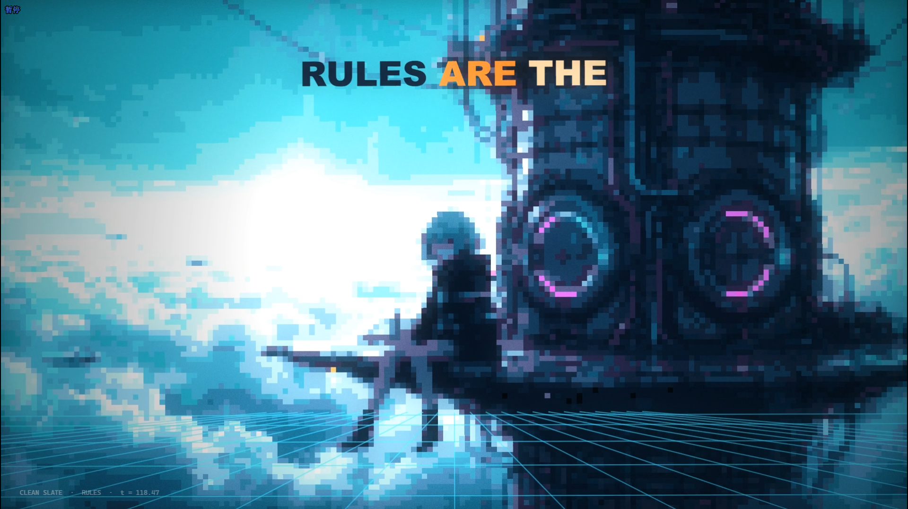
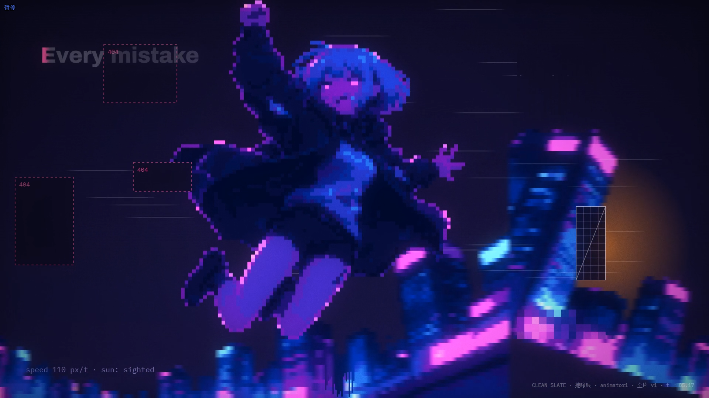

## **Animator2:**
信息太少，运动太简单太少，没必要每个鼓点都让全屏元素抖动太死板。但是画风不错，和其他俩很不一样。

## **主对话：**
静帧应该只用于部分展示画面且也得有元素在动，Morph或剪报或给seedance

运动元素应该更多，

0 1 0 1的时候背景可以有数据流在滚动

Lights On 的时候应该伴随比如MG由下往上元素和画面展开（别局限，自己想）

I was dust in a data sea 的时候可以有主角在 data sea 里 飘荡的运动画面，可以抽象或像素化一点，得让人看得出来这的确是data sea

eyes in the dark pink gold 很奇怪，哈哈，眼睛奇怪，而且眼睛下方没有被搜索的东西。得让人知道这是multi head 啥的呀，整部片子都得如此，得让人知道在描述什么

很多城市画面太具象，一点不像数据世界，不过反正这也得等我重新生成的哈哈

没必要每个鼓点一直在抖，而是每次运动的动势都有指向或行为意义

Clean Slate的时候可以展示女孩在工作空间里，想象的工程室或用户的桌面都行？
can't hear the music... in my feet的时候可以展示女孩和 prompt或用户的交互，在进行音乐创作

第二次 Layer by layer, line by line的时候可以展示工作进度已经有变化了

now i can walk, now i can run 的时候展示 agent在各个 软件、代码、音轨之间穿梭

and it's dancing with me 的时候，我想想，可以想个很酷的效果，我去回顾一下eidolon，或者新想一个？
不错，第一版全片其实就可以作为我展开想象的分镜板

Code in the morning的时候要不要MG展现一下累瘫的用户啥的，幽默一点

这个镜头不错，因为主角像自由游荡到数据世界高塔上，在记录、规划、爱上这种感觉，脚下可以有蹦出的图形或频谱音轨之类的。

可以多来一些虚拟世界的坐标、律动的山脉、受音乐影响的moving walls、鸟群等等（自己发挥想象力），隐喻音乐、情绪、LLM架构里活跃的东西、软件的原理等。 

也用一些东西展现工作流的实际工作状态

When the windows closes ... 的时候可以真的有something closing(MG或隐喻的建筑)，凄美一点。对应关闭软件、电脑啥的。

I forget you face 的时候可以聚焦主角的神情

Brand new place的时候需要光从上方打开，一个世界展开的 类似回到地表世界的那种激动

every time every time 的时候，我想想，得recall 闪回还是啥的？gimme some 灵感 see see 

## **Animator1:** 

对应显示的意思看出来了，但是元素太简单，画面太静，

I came falling from the sky 的时候这里其实可以转 camera motion 更动漫更有冲击力（或更狼狈😅）

其实长画面是女孩的时候，女孩是一定要用动作的，可以pose show一点毕竟是MV，提到过，前面说要不K动画，要不我交给seedances

这个画面不错，做成在各个domain、各个数据空间中穿梭就会有很有感觉

Hey，明显，我给你的参考图，还有之前的参考库和参考库short里的效果很多还没探索嘛，可以试着在js web里实现实现

wake up .. Brand new day.. 的时候你这里一定要有抬头动作（换其他画面也有类似情绪表达，因为这里歌声表达很细腻）

## **...**

其实歌词还可以改改，有更多信息展现AI实际工作流程 和内心情感。更加story telling

总之，很棒！今晚继续探索！yeah ٩(๑>◡<๑)۶

还有，`风格小样_她睁眼_v4/v5`里5秒后的动效部分这里做得尤其棒，值得鼓励哦！Hoola!
